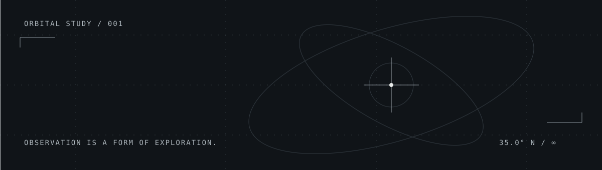

ANWITA JINDHAM / GEORGIA TECH

# Curious about the world. Building things to understand it.

I'm a **Mathematics & Computing** student at **Georgia Tech** who likes the overlap between **code, data, and science** — especially anything involving Earth, space, or AI.

I started out writing little programs and somehow ended up experimenting with full-stack apps. Still figuring out a lot of the tools along the way, which is half the fun.

AN ORBITAL STUDY / ALWAYS EXPLORING

---

## Things I've been making

### [Dancr](https://github.com/anwitaj11/Dancr) / AI meets dance

A hackathon experiment in turning dance videos into tutorials with pose tracking and voice feedback. As someone who's danced for years, this one felt especially personal. **AI-assisted prototype; still a work in progress.**

REACT / FASTAPI / MEDIAPIPE / ELEVENLABS

**[MentHers](https://github.com/anwitaj11/MentHers)**  
An AI-assisted prototype for matching mentors and mentees around their goals and interests.

---

## Lately

**Learning** / Git, web development, and how real software projects fit together.  
**Exploring** / Data science, machine learning, Earth observation, and planetary science.  
**Enjoying** / Projects that mix technical problem-solving with something creative.

PYTHON / JAVA / JAVASCRIPT / REACT / FASTAPI

---

MORE EXPERIMENTS COMING SOON.
