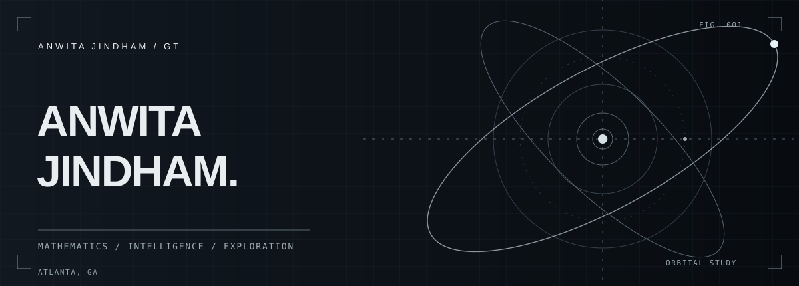
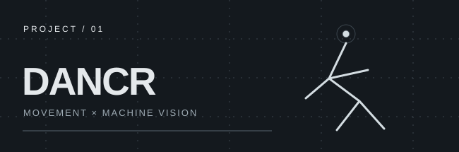
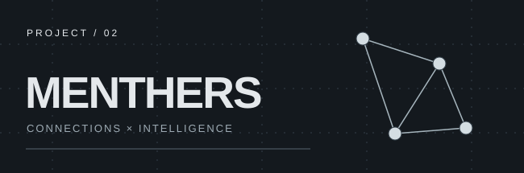

ANWITA JINDHAM &nbsp; / &nbsp; GEORGIA TECH &nbsp; / &nbsp; 2026

 

<table>
<tr><td width="62%" valign="top">

### Hello, I'm Anwita.

I'm a **Mathematics & Computing** student at **Georgia Tech**. I like projects where code crosses into other worlds — **Earth science, space, data, AI**, and sometimes dance.

Still learning how to build things properly. Usually figuring something out by making it.

</td><td valign="top">

QUICK COORDINATES

**01** &nbsp; Mathematics + Computing  
**02** &nbsp; Atlanta, Georgia  
**03** &nbsp; Data / Earth / Space  
**04** &nbsp; Creative technology

</td></tr>
</table>

 

## 01 &nbsp; / &nbsp; Selected work

<table>
<tr>
<td width="50%" valign="top">

### [Dancr ↗](https://github.com/anwitaj11/Dancr)

An AI-assisted dance coaching prototype using pose tracking and voice feedback. Combining two things I love: dance and exploring what technology can do.

REACT &nbsp; / &nbsp; FASTAPI &nbsp; / &nbsp; MEDIAPIPE &nbsp; / &nbsp; ELEVENLABS

</td>
<td width="50%" valign="top">

### [MentHers ↗](https://github.com/anwitaj11/MentHers)

An AI-assisted mentoring platform prototype designed to match people through shared goals, interests, and preferences.

REACT &nbsp; / &nbsp; NODE.JS &nbsp; / &nbsp; SQLITE &nbsp; / &nbsp; CLAUDE API

</td>
</tr>
</table>

 

## 02 &nbsp; / &nbsp; Things I'm exploring

<table>
<tr><td width="50%" valign="top">

**↗ DATA & INTELLIGENCE**

Finding patterns in data and understanding how machine learning works.

</td><td width="50%" valign="top">

**↗ EARTH & BEYOND**

Climate, Earth observation, space, and planetary science.

</td></tr>
<tr><td valign="top">

**↗ BUILDING SYSTEMS**

Getting better at Git, web development, and the fundamentals behind real applications.

</td><td valign="top">

**↗ CREATIVE COMPUTING**

Where technology meets movement, design, and unexpected ideas.

</td></tr>
</table>

 

---

<table><tr><td width="65%" valign="middle">

THINGS I'M WORKING WITH

Python &nbsp;·&nbsp; Java &nbsp;·&nbsp; JavaScript &nbsp;·&nbsp; React &nbsp;·&nbsp; FastAPI

</td><td align="right" valign="middle">

CURIOUS BY DEFAULT. &nbsp; ALWAYS EXPLORING ↗

</td></tr></table>
